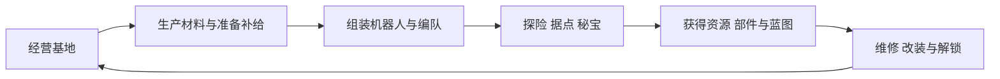

# PunkLegion

来源：https://chatgpt.com/space/page_6aefe98e48fc8191879bf4294ba5ae00  
快照日期：2026-11-19；序列：54。此文件为快照，后续更新以来源页面为准。

## 关于 PunkLegion

本项目通过完成一款真实 线上对战网游来探索 Ai在游戏行业的发展能力现状

查看当前能玩到哪里、下一节点及在做任务的理由，请从[研发进度总览｜安卓独立内测](https://chatgpt.com/space/page_c894f922bf588191bf36f9527b7e1016)进入。

```codex-prompt
帮我为这个空间写一段简短介绍。先问我这个空间是做什么的，再根据我的回答更新此页面。
```


# 游戏策划方案

版本为确认方向后的立项讨论稿，更新日期为2026年11月8日。PunkLegion是一款面向移动端的可爱工业玩具风机器人基地经营与小队战术联机游戏。玩家经营工坊，按接口规范组装机器人，并选择轻度组队PVE探索或面向重度玩家的实时营地争夺。研发采用Blender建模与Godot引擎，由个人与AI协作完成。

产品体验围绕“经营工坊、设计机器人、带队冒险、检验设计、带回资源改造”展开。长期目标是拥有一座有个人风格的基地、一支记得住每台成员的机械军团，以及能够与好友共同争夺的世界据点。

## 一 已确认方向与设计边界

| 项目 | 当前方向 |
| --- | --- |
| 平台与联机 | 移动端在线游戏，基地异步经营，主动战斗支持实时联机 |
| 战斗方式 | 即时小队战术，自动执行基础行为，玩家进行少量手动指挥 |
| 战败损失 | 机器人身份、已拥有部件和蓝图保留，消耗材料维修，公开营地可以丢失 |
| 游玩节奏 | 轻度PVE日常15至30分钟，私人基地有离线恢复保障；公开占领营地面向重度玩家，无专属离线保护 |
| 核心特色 | 规则化模块组装、有限兵力下的数量与质量选择、私人经营与公开争夺并存 |
| 私有基地 | 不被其他玩家占领，只遭受受控的野生机器人袭击 |
| 当前文档性质 | 完整的系统设计起点；表内规模、比例、时长和经济数值为原型测试初值 |

首版先验证经营与组装是否能自然支持战斗。赛季制、自由交易、永久部件损毁和大规模公会战争暂不作为既定需求。美术采用可爱工业玩具风，Blender负责建模，Godot负责游戏实现，团队为个人与AI。商业模式为外观收费与轻量道具收费，道具范围和数量限制需在研发前明确。

## 二 世界观与美术方向

### 世界背景

一场能源网络灾难使旧文明的自治机械失去统一指令。幸存者在废墟上建立工坊聚落，使用蒸汽动力、机械传动与残存芯片重建生活。玩家扮演一名工坊领主，寻找旧时代核心，修复机器人，并与其他工坊共同探索失控网络。

蒸汽朋克负责机械结构与生活质感：锅炉、黄铜、铆钉、履带、管线、吊机和工业厂房。赛博朋克负责信息与能源层：神经接口、霓虹标识、黑市芯片、故障全息投影和失控人工智能。两者通过“旧机械承载新智能”的规则统一，避免单纯堆叠元素。

### 视觉与辨识

美术确定为可爱工业玩具风，以Blender制作3D场景和机器人，并采用blender-pikachu-diorama规范：短胖方块主体、清晰轮廓、有限色块、局部2至3档明暗、手绘纹样和有层次的微缩环境。该规范在本机的来源为 `C:/Users/alienware/.codex/skills/blender-pikachu-diorama/SKILL.md`。正交斜俯视作为首轮验证起点；迁移到原创朋克题材时保持风格语言，独立机器人不附带展示地台。Godot中的材质、阴影和动画需通过实际导出物验证后，再形成游戏资产规范。

机器人在远景中也要能区分移动底盘、主要武器和重型程度。颜色、编号、涂装与小型装饰用于表达归属；付费外观不得遮盖武器类别、体型或技能提示。音效区分蒸汽泄压、履带、机械足、过热警报与核心失稳。

## 三 核心循环与每日体验



基地建设提供出征能力，探索带回新部件，部件带来新战术，战术帮助玩家挑战新区域。研究主要解锁新功能与新接口，不持续叠加全军攻击力。

### 一次约20分钟的登录

1. 用2至3分钟领取生产、查看战报、安排维修和建筑任务。

2. 用3至4分钟调整一台机器人或替换编队。

3. 用8至10分钟完成两场探险，或一场组队秘宝战。

4. 用2至3分钟领取探索与生产收益、安排维修和下次任务；参与重度营地玩法的玩家可另行查看驻军和争夺时段。

常规探险目标为3至5分钟，秘宝与据点单场战斗目标为4至6分钟；组队匹配、战前准备和结算也计入轻度PVE每日时间预算。公开占领营地是自愿参与的重度路线，不要求其争夺总时长落在15至30分钟内。组队支持连续两局、保留队伍，减少反复等待。

日常奖励集中在少量主要活动中，避免多个模式分别要求签到。每日基础进度可由经营、探险、协作等不同活动替代完成。连续离线不会造成机器人退役或基地倒退，离线生产暂以24小时储量作为测试起点，额外离线时间停止累积且不倒扣。

## 四 私有基地与经营系统

### 空间与建设

基地采用可扩展网格，初始只有工坊核心、仓库、基础装配台和少量空地。首次亲自打通锈轨回收场后，私人基地免费解锁相邻地块。单人或组队均按本人的胜利回执判定。首轮试验将东侧三列共 27 格开放建造，原有道路、建筑和机体留在原位。外围遗迹、障碍与资源点使布局形成长期变化。

道路影响通行，管线与供能范围影响建筑运转。首版只保留供能范围与道路两类清晰规则，不同时叠加复杂水、电、蒸汽物流模拟。建筑可免费移动；移动战斗设施在袭击锁定后于下一场生效。

### 主要建筑

| 建筑 | 主要作用 | 限制与取舍 |
| --- | --- | --- |
| 工坊核心 | 基地阶段、领地扩展与功能入口 | 阶段数量有限，受损后修复，不永久摧毁 |
| 装配车间 | 制造、改装、保存机体方案 | 同时施工队列有限，允许排队 |
| 军营与机库 | 管理机器人、编队与出征状态 | 机库容量高于出战台数 |
| 冶炼厂与零件厂 | 产出结构材料、加工通用件 | 占地、供能与离线仓储限制 |
| 能源站 | 生产出征与维修所需能源 | 不作为所有功能都要消耗的单一体力 |
| 仓库与保险库 | 存储资源，保护基础恢复物资 | 保险库保护额度明确可见 |
| 研究站 | 解锁接口、底盘和功能蓝图 | 解锁路线而非无限属性等级 |
| 修理站 | 点站房查看战损、送修和查看剩余时间 | 常驻一个基础工位；至少一座修理站供电时再开放一个工位，可同时维修两台，每台仍需 30 秒。保留基础救援。 |
| 雷达与远征站 | 探索、袭击预警、世界地图入口 | 情报有时效，不自动暴露所有对手 |
| 防御机器人平台 | 建造固定底座，安装一件自有的兼容武器或功能件，供能后执行对应防守动作 | 已装件占用唯一实体；拆下后可装回机体或其他平台。平台受防御预算、供能和射界约束 |
| 装饰设施 | 展示工坊风格与机器人收藏 | 不显著增加袭击难度 |

建筑成长以解锁布局选择、生产方式与用途为主。首版可测试3个基地阶段，避免数十级建筑形成重复升级链条。

## 五 机器人组装与个体身份

### 从方案到实体机器人

组装界面设计机体方案，装配车间按方案消耗材料制造实体机器人。相同方案可以制造多个个体，但每个个体拥有独立编号、名称、涂装、服役记录和当前任务状态。

玩家可为机器人命名、标记收藏，在机况页查看战损和修复状态。熟练度主要解锁外观、称号与行为设置；若保留战斗加成，必须很小且有明确上限。机器人“值得记住”依靠外形、职责和经历，而非高额永久损失制造压力。

机器人当前不设计性格、对话或人格系统。每台机体的服役档案保留三项累计值：实际参战场数、末击击败的敌机数、在战斗中为友机实际恢复的耐久。服务器按永久机体编号在结算时记一次；改名、换装和重登后累计值仍归原机。新机三项均为零。

### 接口标准

| 模块 | 约束内容 | 示例 |
| --- | --- | --- |
| 底盘 | 最大载重、移动方式、机体等级与插槽布局 | 双足、履带、轻型轮式 |
| 动力核心 | 连续功率、短时输出与散热负担 | 稳定蒸汽核心、短时高输出核心 |
| 武器 | 安装尺寸、接口类型、射界和功率 | 机枪、火炮、喷焰器、近战臂 |
| 防护 | 装甲重量、抗性与覆盖位置 | 轻装甲、正面盾板、隔热层 |
| 功能件 | 专用插槽、耗电与功能互斥 | 修理器、雷达、干扰器 |
| 控制模块 | 可用行为与技能 | 护卫、侦察、阵地支援 |

装配合法需要同时满足：插槽存在、机械接口兼容、尺寸匹配、总重量不超过载重、持续功率不超过供给、散热满足规则、关键功能无互斥。首版建议使用少量标准接口，不做自由物理拼接与任意角度连接。 首轮安卓内测加入占用功能槽的维修部件。装有该部件的机体可以修复队友，施修机按实际恢复的耐久累计维修输出。满血维修的有效输出为零。

武器或核心替换可能改变机体指挥点，避免轻型底盘安装顶级武器后仍按廉价机计算。系统先校验接口，再根据底盘与模块的战术成本计算指挥点；确认装配前显示最终出战费用和不能出战的原因。 战术目镜多占 1 个指挥点。它让机体更快锁定新目标，首发提前；同一目标的持续射速沿用原武器设定。重新集火仍须等待已有武器冷却和干扰结束。

### 有代价的构筑选择

高功率武器牺牲装甲、散热或续航；厚装甲增加承伤能力，但降低移动和转向；支援机提供维修或干扰，却占用输出位置。高级模块增加特殊能力，其基础效率必须受重量、功率、冷却与指挥点共同约束。

模块不采用无限随机词条和无限强化。可以设置有限的技术层级与少量可选调校，稀有部件的价值来自改变玩法。新手模块也应在低成本编队中保持用途。

### 典型机体

| 名称 | 构成与定位 | 明确弱点 |
| --- | --- | --- |
| 铆钉侦察机 | 轻型轮式、雷达、轻机枪，负责侦察与抢点 | 装甲薄，难以正面对抗 |
| 铁砧护卫机 | 履带、正面盾板、短程武器，保护后排 | 转向慢，怕侧翼和干扰 |
| 烟囱火力机 | 蒸汽核心、榴弹炮、散热件，压制密集部队 | 对机动目标命中较差 |
| 线圈干扰机 | 兼容底盘装功能槽干扰器，短暂推迟敌机下一次武器和维修动作，敌机仍可移动 | 占用维修件所需的功能槽，同一目标有共享保护期。首轮试验为延迟 1 秒、保护 4 秒 |
| 黄铜修理机 | 修理臂与维修储能，维持阵线 | 维修总量有限，不能无限拖延 |
| 哨戒炮塔 | 固定底座、武器、供能接口，保护入口 | 无法追击，受地形与供能限制 |

## 六 部队规模与数量质量平衡

### 初始规模方案

单人标准战斗采用“24指挥点、最多12台有效单位”的双重上限。轻型机参考2点，标准机参考3点，重型机参考4点；特殊模块可能额外增加费用。这里的费用是原型平衡起点，不能直接视为最终强度比例。 1010 内测允许每人持有 18 台。按两个营地的正式 20 Hz 规则完成了 100 场基准和 28 场补充推演。在同为 24 点时，12 台基础气炮对 6 台强化维修气炮赢了 16/16 场；6 台强化钻对 12 台基础气炮赢了基准 8/8 场。本轮保留 12 台与 24 点用于试玩，接下来重点观察远程牵制近战的手段，以及玩家能否记住具体机体的贡献。

| 示例编队 | 指挥点 | 台数 | 取舍 |
| --- | --- | --- | --- |
| 12台基础轻型机 | 12乘2等于24 | 12 | 占点与包抄强，怕范围伤害 |
| 8台标准机 | 8乘3等于24 | 8 | 职责均衡，突出搭配 |
| 6台重型机 | 6乘4等于24 | 6 | 正面强，地图覆盖较弱 |
| 4台轻型加4台重型 | 4乘2加4乘4等于24 | 8 | 侦察与攻坚配合，重型损伤代价高 |

机库暂以24台实体机器人作为测试容量，可保存多个方案。机库扩容不提高单场指挥点。首版不允许单位生产子单位绕过上限；若未来加入无人机，其数量与费用一并计入。

### 多人与防御容量

据点攻防每方共24点、最多12台，守方包括驻军、防御塔和好友援军。好友援助占用接收方预留额度，不叠加额外军队。

双人争夺秘宝按个人计算，每人最多12指挥点、6台机体。队友的剩余额度不可借用。双方分别选好机体，确认同一份阵容后再参加匹配。单人参加秘宝时，每人最多24指挥点、12台。这样保留玩家参与感，控制战场规模。组队PVE可用3名玩家各12点、最多6台，敌方同时活动单位也需封顶，增援分波进入。

战斗单位上限是规则与性能的共同约束。原型优先验证约24台单位加场景效果的标准战斗，再验证组队PVE的更大数量；移动端是否能承受必须实机测量，不能由纸面预算保证。

### 平衡手段

数量优势体现为占点、分路、侦察、牵制和攻击覆盖；质量优势体现为耐久、突破能力和技能组合。范围伤害、地形阻挡、弹道、转向、过热与维修容量共同形成克制。

避免所有技能都能无限叠加：同类光环只取最高值，维修有目标效率衰减和总储能，控制效果有递减或短暂抗性。不能靠一个“综合战力值”判定编队一定公平，应比较不同地图、操作水平和阵容之间的表现。

## 七 即时战斗与移动端操作

机器人自动索敌、移动和执行预设职责。玩家主要使用点选小队、移动、集火、撤退与少量主动技能；不要求逐个单位高频操作。默认提供前排、火力、支援三组快捷选择，允许玩家自定义分组。

战前可设置护卫目标、交战距离、目标优先级和撤退阈值。规则使用可理解的选项，不做需要编程的行为脚本。技能需要明确预警与效果范围，关键状态如过热、断电、被干扰必须直接可读。

常规胜负由占点、护送、核心破坏或限时采集决定。超时按公开目标进度结算，防止无限维修与躲藏拖局。撤退允许保住部分任务成果，已投入的出征消耗不全部返还。

实时联机支持短时重连，掉线期间的基础行为及超时处置须由服务端统一规则裁定。公开营地不提供离线AI代守保障；已经部署的机器人和防御塔可执行正常基础行为，但缺席不阻止营地被攻占。机器人不能同时出现在两场战斗中，进入战斗时锁定阵容、部件和资源，战后统一结算状态。

## 八 世界地图与公开营地

### 地图结构

世界地图由有限区域和可达路线组成，区分可占领的竞争营地与不可占领的PVE探索区域。竞争营地面向重度玩家，组队PVE探索面向轻度玩家。玩家主基地是独立私有空间，地图入口展示工坊名片，不暴露可被其他玩家攻击的主基地实体。

首版采用分区世界，控制每区活跃玩家与据点数量。具体人数由并发、争夺密度和匹配测试决定，不能直接假定所有玩家处于同一无缝世界。

### 营地获取与收益

可占领营地由玩家清理中立守军或击败当前守方后取得控制，双方在服务端开放的时段实时参战。营地提供特种材料、区域情报或额外收益；基础部件与核心成长材料仍应有PVE获取路径，轻度玩家无需占地也能完成主要成长。

每名玩家暂以2个公开营地为上限。营地的建设范围限于防御槽位与资源建筑，完整经营设施保留在私人基地。开发版首轮开放一座采集站：黄铜转运场消耗 2 份结构材料，线圈港消耗 2 份通用零件。建成后每 12 分钟产 1 份，基础为每 15 分钟产 1 份，两者最多存 8 份。守住保留设施，失守清除当地设施和库存；夺回后可以再次投资。收益进入当地有限仓储，定期或手动转入主基地，首版不加入需要长时间护送的常态运输车。

成熟后的基地自给能力应覆盖基础发展，公开营地提高选择和效率。失去全部公开营地后仍能正常游玩，避免弱者因失地失去翻盘能力。

### 服务端开放时段与实时攻占

公开占领营地的开放时间由服务端统一配置和公布，客户端展示服务器时间及倒计时。开放期间进行实时争夺，关闭期间不接受新攻占。具体每日场次、时长与跨时段战斗的结算边界属于下一步规则配置，不再由守方选择个人窗口或使用预约攻占。

公开营地面向愿意承担失地风险的重度玩家，不设置轻度玩家保护、每日最多被攻击一次或专属离线保护。防守者缺席仍可失守，系统不凭空生成离线守军。固定防御塔与已部署单位按正常战斗规则运行，实际玩家到场时实时指挥自己的小队。

战斗创建时由服务端锁定营地归属版本、参战单位与资源，防止同一营地重复结算或同一台机器人重复出征。攻击成功转移营地控制权及规则允许的当地有限库存，主基地仓库、机器人身份和已拥有部件不进入PVP掠夺池。

不设置营地失守后的玩家保护期。必要的战斗互斥、关闭时段与结算锁只用于保证规则一致和并发正确性。营地收益仍有个人额度与防互刷限制，重度参与带来额外收益和荣誉，不形成轻度玩家无法获得的必备战力。

## 九 探险与秘宝区域

### 营地周边探索

私有基地周边分布废墟、封闭工厂和旧武器库。推进探索可获得部件、蓝图片段、扩建地块和环境事件，形成“发现一件装备，立刻想回去装上试试”的体验。 锈轨回收场首胜给一件可装机钻头，并计作配方进度 1/3。累计三次个人胜利，免费掌握钻头永久制造配方。单人和组队共用进度，也可提前在工坊研究。

探索节点兼顾一次性发现与可重复资源任务。重复任务对已完成的简单关卡开放快捷处理，但新机制、首领和关键部件首次获取仍需实际战斗。基础进度无需依赖稀有随机掉落。

### 秘宝的两种入口

| 类型 | 参与方式 | 奖励与风险 |
| --- | --- | --- |
| 协作遗迹 | 单人或1至3人组队，战斗内不互相伤害 | 保底探索材料、首领部件与蓝图进度 |
| 争夺秘宝 | 独立入口，首版建议2对2小队竞争 | 较高奖励上限，携带战利品需要撤离 |

秘宝与探索区域由世界事件临时出现，不可永久占领。轻度入口为单人或组队PVE，限时完成采集、开锁、首领或撤离目标。争夺秘宝保留为后续独立PVP模式，优先级低于组队PVE与公开营地；协作玩家不会被强制转入PVP。

稀有掉落采用有限随机加进度保底。争夺失败仅损失本局尚未带出的部分战利品与维修成本，入场前已有部件保留；完成最低目标可获得少量不可被夺的参与奖励。每日额外场次保留玩法乐趣，稀缺材料收益设递减或上限。

## 十 好友与协作

好友可以参观基地、分享机体方案、组队出征，或派遣实体机器人援助公开营地。方案分享不复制部件，需要接收者自行收集或制造。

好友可派遣实体机器人驻防，部署与召回在战斗锁定期间受限；已派遣单位不能同时出征。营地实时战斗中，在线援助者指挥自己的小队，离线部署单位只执行正常基础行为，不构成额外离线保护。双方所有驻军、防御塔与援军共同受队伍预算限制。

战损维修责任在派遣界面明确，首版建议系统发放协防维修补偿、由援军主人最终维修，不允许接收者直接扣除好友仓库材料。补偿只覆盖合理损耗且不产生净资源，防止故意送死套利。

实时合作时各玩家控制自己的小队，队长只能发送集火或移动建议。匹配提供基础职责提示与短语标记，非必须语音。公会与跨公会战争放在核心循环成立之后。

## 十一 资源与长期经济

### 资源分层

| 类型 | 来源 | 主要用途 | 控制方式 |
| --- | --- | --- | --- |
| 结构材料 | 基地产线、探索、回收 | 建筑、机体、维修 | 有限产能、仓储、持续出征消耗 |
| 通用零件 | 加工、任务、探索 | 模块制造、改装、维修 | 加工能力与制造配方 |
| 能源 | 基地生产、任务 | 出征、部分技能补给、维修 | 储量与单位任务成本 |
| 特种材料 | 指定区域、首领、秘宝 | 特定功能部件 | 有限供给、用途明确、替代获取路径 |
| 实体部件 | 遗迹、制造、阶段奖励 | 装配机体 | 接口限制、库存与回收规则 |
| 蓝图与研究进度 | 探索、任务、保底兑换 | 解锁制造与新功能 | 有限科技树，无限等级不开放 |

首版先验证前三种通用资源及少量特种材料，不同时引入多套用途重叠的货币。体力不足时仍能调整基地、组装方案、参观和参与低奖励训练，不把所有行为都绑在能源上。

### 防止数值膨胀的规则

生产量、建筑阶段、机器人技术层级与指挥点都有边界。新增内容优先加入新的射界、移动、环境适应与协作能力，不持续增加基础伤害倍数。

公开营地收益设置个人上限，好友援助与重复对手奖励受约束。PVP掠夺只能转移已存在的可掠夺资源，部分资源作为运输损耗移除，不凭战报额外生成同量奖励。

机体建造、任务补给、战损维修、重新部署和主动改装消耗资源。回收返还低于原制造投入，修好再回收也不能套利。低损耗玩家仍可能积累资源，因此需要仓储边界、可自愿重复的外观制造与长期委托等消耗；这些不能兑换无限战斗属性。

首版不开放玩家间自由资源转账或拍卖行，以减少倒卖、工作室与小号输送。后续若开放交易，需要独立设计税、流通范围与反作弊。

### 一份可计算的资源样例

以下只是单日活跃玩家的模拟账本，使用归一化资源单位；不代表每天必须扣除的固定费用。各项支出只在玩家主动出征、维修和制造时发生。

| 项目 | 结构材料 | 通用零件 | 能源 |
| --- | --- | --- | --- |
| 基地与活动合计产出 | 100 | 40 | 60 |
| 出征与据点部署 | 20 | 5 | 20 |
| 正常战损维修 | 25 | 10 | 10 |
| 制造与改装 | 35 | 15 | 15 |
| 剩余可积累 | 20 | 10 | 15 |

这一账本只能说明某种活动量下的收支，不能证明经济稳定。测试必须分别模拟新手、毕业玩家、零战损玩家、频繁失败玩家和公开营地长期持有者。高级玩家制造需求下降后，需要重新检查剩余资源，而非强行提高全部人的维修费。

保留基础救援能力：当玩家缺少出征与维修资源时，可使用不可转让的救援配额修复最低可玩小队，奖励受限，避免“败一次就无法再玩”和反复触发救援牟利。

## 十二 野生机器人袭击与财富系统

### 袭击的目的

袭击检验基地布局并制造可恢复的经营事件。敌人包括失控巡逻机、回收蜂群、重型拆解者等，可对不同防御布局形成变化。系统不能把玩家每一次成长都立即换成等比例惩罚。

### 财富与威胁计算

使用统一标准价值评估可掠夺库存、已部署设施和可用战斗资产；外观收藏与纯装饰尽量不计入或低权重计入。资产按系统标准成本估值，避免玩家市场价格影响威胁。

原型可用“库存价值乘0.45、设施价值乘0.25、战斗资产价值乘0.30”的加权和作为有效财富，再通过分档或递减增长函数映射敌方预算。权重和函数都需调试，不能直接当作成熟平衡。

威胁预算综合财富档位、基地阶段、近期袭击记录与恢复状态。财富影响强度而不影响为玩家规定的袭击次数上限；每个阶段都有上限，不能出现库存略增就跨越数倍难度的突变。

使用跨任务的账户资产口径，援军、外派和入场背包不能从财富中消失；同时使用一段时间的平滑值降低临时搬仓套利。战败后优先按真实恢复能力降低压力，历史峰值不得让已受损玩家持续遭遇过强袭击。

### 离线处理与战败恢复

袭击需预警，并显示方向、敌人类别、预计强度和可损失资源。首版从每日最多一次有损袭击、提前数小时预警测试起步，不能每次上线都触发惩罚。

离线时按已保存基地与阵容由服务器自动结算，玩家上线后查看战报或回放，不强制守候。预警期间可调整，锁定后变更于下一次生效。失败后保护期暂以48小时作为测试起点，期间不发生新的有损袭击。

掠夺只影响超出保险额度的通用库存，首轮测试可将损失设为“可掠夺池的10%以内，同时不超过该玩家一个正常活跃日预期产出的20%”。随机只决定有限池中各资源的分配，不随机突破总上限；界面提前显示最大可能损失。

机器人、蓝图、已装配部件和付费物品不进入掠夺池。建筑被破坏后表现为停工或受损，修复成本有上限，基地不会被清空。维修总损失与掠夺一起统计，避免只限制掠夺却让维修代价失控。

## 十三 成长 节奏与公平性

前期让玩家快速体验制造、探索和有意义的替换；中期开放不同底盘与协作任务；后期围绕功能收集、编队精进、基地风格和有限领地竞争展开。

建议新手前30分钟获得三种职责的基础机器人，完成一次部件替换和一次主动指挥；第一天无需进入PVP也能形成完整体验。公开营地在完成必要教学后由玩家主动解锁，参与前说明失守规则。

组队PVE按技术阶段和任务难度组织，独立竞技活动可使用模板或归一化规则。公开占领营地保留成长差异并明确风险，不以轻度玩家保护规则限制争夺；轻度玩家可通过PVE完成基础成长。

联机成长必须有明确终点。若未来采用赛季，优先轮换世界事件、秘宝环境与赛季荣誉，保留私人基地和机器人收藏；公开领地是否重置需另行确认，当前不预设强制清档。

## 十四 商业化边界

商业模式确定为外观收费与轻量道具收费。外观包括机器人涂装、基地装饰与可读性合格的特效。轻量道具的品类、价格、购买上限和免费获取渠道在商品设计阶段逐项确认，当前不将具体消耗品自动视为已批准商品。

不直接出售额外战场指挥点、独占强力部件、免受攻击的长期特权或突破收益上限的资源倍率。首轮测试商店提供机器人外观和装配方案栏。每个账号免费保存 6 套方案，每次可加购 1 套，最多加购 2 套。方案记录部件配置；实际装配仍需持有对应部件，并遵循统一的指挥点限制。首轮以模拟订单验收。平台先做安卓独立内测；正式发行渠道、渠道账号和支付沙箱在选定平台后接入。

轻量道具若涉及能源、维修或加速，必须评估其是否通过出战频率、经济产能或营地持续作战能力产生明显付费优势，再决定是否纳入。商城先使用测试商品与模拟支付，真实支付接入、退款和补单属于上线前独立验收模块。

## 十五 主要界面与信息结构

| 界面 | 玩家主要任务 | 必须看清的信息 |
| --- | --- | --- |
| 基地主界面 | 布局、生产、维修与防守 | 离线储量、预警、可恢复状态 |
| 装配车间 | 换底盘、装部件、保存方案 | 接口兼容、重量、功率、指挥点变化 |
| 机器人档案 | 查看个体和安排任务 | 名称、职责、战绩、维修和派遣状态 |
| 世界地图 | 寻找营地、探索与事件 | 风险类别、时间窗口、收益上限 |
| 编队界面 | 分配单位与行为 | 全队预算、职责缺口、任务锁定 |
| 战斗界面 | 移动、集火、技能和撤退 | 目标进度、关键状态、队伍分组 |
| 战报界面 | 理解胜负与调整 | 资源净变化、维修费用、关键失败原因 |

红点只提示真实待处理事项，不以反复清除红点作为日常内容。自动防守战报先给结果与损失，再提供回放，保证轻度玩家几秒内能处理。

## 十六 联机与服务端设计原则

客户端负责操作与表现，服务端裁定制造、部件归属、资源、战斗关键状态与结算。掉落、占领结果与维修费用不能由客户端提交最终数值决定。

基地经营采用异步任务与离线产出时间戳，世界地图记录据点归属与服务端开放日程，战斗采用独立房间。公开营地与组队PVE使用实时服务器裁定；私人基地野生袭击可离线模拟结算，二者复用核心战斗规则并区分各自参战政策。

每台实体机器人有唯一身份与任务状态；出征、驻防、援助和维修互斥。资源扣除、战斗创建、结算与奖励发放需要可重试且不重复到账，公开营地争夺需要唯一锁，避免并发占领。

私人基地的离线野生袭击在阵容锁定后由服务端模拟，保存关键事件与结果；公开营地采用实时战斗，不提供专属离线AI代守。实时房间支持短时重连。玩家在玩法战报查看本场结果、收入和战损，在机体档案查看服役累计。野袭回放按本场防守快照呈现。

先验证单区域和少量模式，再评估跨区匹配、持久大地图与大规模活动。服务端并发、单位寻路和弹道表现都需要实际压测。

## 十七 首版范围与开发阶段

### 可玩原型

先实现一个小基地、一套装配规则、一张战斗地图和少量可区分模块。用单人PVE证明组装能改变战斗决策；同时尽早验证两人实时联网、断线接管与服务端结算，避免把网络可行性留到最后。

初始内容可从2种底盘、2种核心、6种武器、4种功能件和2种防御塔起步。这些数量是控制制作量的建议，不要求把所有模块组合都视为独立内容完成。

### 封闭联机测试版本

包含私人基地、受控野生袭击、一个1至3人协作遗迹、服务端开放时段内实时争夺的公开据点与好友援军。资源先使用三种通用资源加少量特种材料，只开放有限科技阶段。独立争夺秘宝放在这些模块通过后扩展。

分别验证组队PVE与实时营地争夺，避免一种玩法的进度与平衡迫使另一类玩家参加。暂缓自由交易、公会战争、海量随机词条和复杂赛季清档。

### 扩充与上线准备

在核心循环、经济和联网稳定后扩充模块、地图、事件、美术表现、运营工具与商业化。上线前补齐账号恢复、客服补偿、异常结算修复、版本兼容、日志与监控。

团队为个人与AI，开发先按可独立验收模块推进，不承诺日历排期。Godot与Blender的具体版本、首发移动平台、目标设备和服务端部署方式在技术基线阶段确定，再据实际完成速度建立排期。

## 十八 验证指标与调整方法

| 需要验证的问题 | 测试方法 | 调整依据 |
| --- | --- | --- |
| 玩家能否记住机器人 | 试玩后让玩家描述主力名称、职责和一次战斗经历 | 若只记战力数字，强化个体表现并评估减少出战数量 |
| 数量与质量是否都有选择空间 | 同预算阵容跨地图、跨操作水平对局 | 比较胜率、目标进度与操作负担，检查是否出现通吃阵容 |
| 15至30分钟能否完成主要进度 | 记录登录、整理、匹配、战斗和结算全流程 | 减少重复任务、等待与强制次数 |
| 离线保护是否有效 | 模拟离线1天、3天和7天 | 检查恢复成本、损失总额与回归后的可玩性 |
| 财富袭击是否惩罚成长 | 对不同财富与防守水平的账户模拟袭击 | 检查强度跳变、连败与威胁回落速度 |
| 经济是否长期积累失控 | 模拟30天与90天，多类玩家分别核算 | 比较净产出、资源用途、毕业后消耗和救援触发 |
| 援军是否绕过限制 | 测试多好友派遣、召回、同时出征和锁定 | 验证单实体、单任务与队伍预算不被突破 |
| 手机操作与性能是否可接受 | 目标设备实测单位峰值、技能密集场景和弱网 | 根据帧时间、发热、误触与掉线调整上限 |

原型不以商业留存数字替代玩法判断。先确认玩家愿意反复改装、能解释胜负，并愿意主动再打一局，再结合测试样本设定留存、匹配时长与付费目标。

## 十九 主要风险与设计响应

最突出的风险是经营、组装、即时战术和领地竞争同时存在，学习成本偏高。教程应按“先用现成机体作战，再换一个部件，再制造自己的机体”逐层展开，暂不开放复杂接口与所有世界入口。

第二个风险是轻度PVE与重度领地竞争共享经济后出现成长绑架。私人资产稳定、核心材料有PVE路径、公开营地收益有界是两条路线共存的前提；公开营地按服务端时段实时争夺，不额外承诺离线安全。

第三个风险是模块组合使平衡与内容成本快速增加。少量接口、清晰功能、互斥规则和自动装配校验比堆数量更重要；新增模块必须检查对所有既有底盘与技能的影响。

第四个风险是实时营地争夺出现并发占领、掉线重复结算或开放时段边界争议。应先验证房间互斥、服务端时钟、重连和唯一结算，再增加据点数量。固定防御设施与在线部队的预算需要共同测试。

## 二十 已确认技术路线与后续讨论

已确认采用Blender建模、Godot引擎、可爱工业玩具风，由个人与AI研发。机器人提供自定义名字、机体收藏与三项服役累计，当前不做性格和对话。下一轮按以下事项形成可执行技术规范。

1. 引擎规范：具体版本、目标平台、渲染方案、场景与数据边界、网络权威、目录命名和测试方式。

2. 建模规范：按blender-pikachu-diorama建立风格样板，并确定比例、原点、接口、活动轴、导出、动画、材质兼容与资产性能验收。

3. 公开营地规则细化：由服务端配置开放时段，确定参战队伍、无驻军占领、关闭前入场截止和跨窗口战斗的处理方式，不再讨论预约攻占与轻度离线保护。

4. 商业化与部署：轻量道具清单、目标手机、发布平台、服务器环境与成本预算。

目前最值得先做的可玩验证是：玩家亲手拼出一支6至12台的机械小队，打一场短战斗，能够理解某个部件如何改变结果，并愿意回工坊调整后再出发。

[Page](page:page_4a8d0df5d3f481919df4dc6f25058920)
